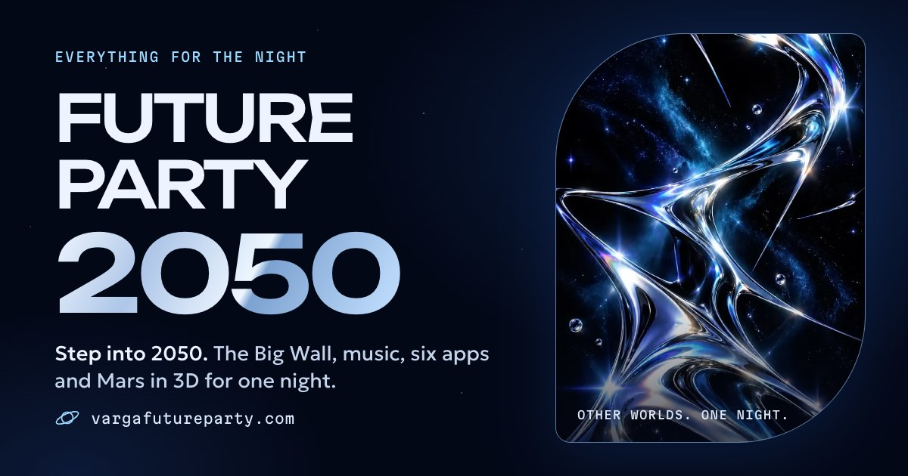

# Future Party 2050

**Everything for a party set in the year 2050**: a Big Wall that plays films, quotes, futurists' posts and concept art in one loop on the projector, six apps for the guests, the music, and the research behind all of it. Live, with no login, at **[vargafutureparty.com](https://www.vargafutureparty.com)**.

[](https://www.vargafutureparty.com)
[](../../releases)

[](https://www.vargafutureparty.com)

**[Open the site](https://www.vargafutureparty.com)** · **[The party app](https://www.vargafutureparty.com/app)** · [The Big Wall](https://www.vargafutureparty.com/wall) · [Mars in 3D](https://www.vargafutureparty.com/mars3d/index.html) · [Films (1080p)](../../releases)

## What is Future Party 2050?

A one-night party where the guests step into 2050, and this repository is the whole night as code and data. Guests tap an NFC pass to meet their Kin, play with webcam effects and a Makey Makey soundboard, look at Mars through red/cyan glasses, and watch the Big Wall: two films, 50 quotes and 25 ideas from books about 2050, 78 posts by futurists and 377 pictures of concept art, sorted into six chapters. Every claim on the wall has a source: quotes are checked against the books, posts are verbatim from X, photos come from NASA, ESA and Wikimedia Commons with their licences.

### Six apps for the guests

| App | What it does | Built with |
| --- | --- | --- |
| [The Future 2050](https://www.vargafutureparty.com/app) | The party's NFC game: tap your pass, meet your Kin (a zodiac creature from 2050, drawn for you), then tap other guests' passes to collect their Kin and climb a live ranking | Next.js, Supabase, NFC tags, [varg](https://varg.ai) image generation ([`app/`](app/README.md)) |
| [Mirror 2050](https://www.vargafutureparty.com/mirror/index.html) | Eight camera effects that went viral on X, played with your hands; nothing leaves the browser | MediaPipe hand tracking, WebGL shaders, one HTML file ([`mirror/`](mirror/README.md)) |
| [History of Music 2050](https://www.vargafutureparty.com/music/resonance/dist/local/index.html) | 60 stops of music history from 1400 BCE, then twelve directions for the music of the future | Python build from JSON, YouTube player (`music/resonance/`) |
| [Play: 2050](https://www.vargafutureparty.com/soundboard/dist/contact2050.html) | A soundboard you play by touching things: twelve pins, eight kits, a jam mode that keeps every touch in time and in key | Makey Makey, Web Audio, [Dirt-Samples](https://github.com/tidalcycles/Dirt-Samples) ([`soundboard/`](soundboard/README.md)) |
| [Mars in 3D](https://www.vargafutureparty.com/mars3d/index.html) | 40 real stereo pictures of Mars from rovers, landers and orbiters, with a live 3D globe | NASA/ESA anaglyphs, three.js ([`mars3d/`](mars3d/README.md)) |
| [Imagined Futures](https://www.vargafutureparty.com/concept-art/imagined-futures.html) | 377 pictures of concept art about the future, each linked to its post and artist | Python build from public posts on X (`concept-art/`) |

### On the wall and behind it

- **[The Big Wall](https://www.vargafutureparty.com/wall)**: every piece below in one loop of about 49 minutes, in six chapters (Planet, Machines, People, Power, Beyond, 2050).
- **Films**: *Further* (16 claims about 2030–2050, each with a dated real seed and the film that imagined it) and *Six Facts* (the show reel), made with [HyperFrames](https://hyperframes.heygen.com), HTML rendered to video. 1080p masters are on the [releases](../../releases).
- **Slide walls**: the [quote wall](https://www.vargafutureparty.com/quotes), the [idea wall](https://www.vargafutureparty.com/ideas), the [tweet wall](https://www.vargafutureparty.com/tweets) and [Imagined Futures](https://www.vargafutureparty.com/art).
- **Research**: [Book Projection 2050](https://www.vargafutureparty.com/books/dist/book-projection-2050.html) (18 books), [2050 in 78 Tweets](https://www.vargafutureparty.com/tweets/dist/tweets-2050.html), [Futurists on 2050](https://www.vargafutureparty.com/tweets/research/futurists-on-2050.html), [Projection 2050](https://www.vargafutureparty.com/reel/projection-2050.html) (18 films), [Why Music Changes](https://www.vargafutureparty.com/music/dist/why-music-changes.html).
- **[Party slides](https://www.vargafutureparty.com/slides)**: the host's 26-slide deck with speaker notes.

## FAQ

**Can I use it for my own party?**
Yes. Open [vargafutureparty.com](https://www.vargafutureparty.com) on the projector laptop and type `/wall`, or clone the repo and open `index.html`: the front page and most pieces run from the folder without internet. The party app needs its own Supabase project and NFC tags; see [`app/README.md`](app/README.md).

**Do guests need an account or an app?**
No. Nothing on the site needs a login, and the party app opens in the phone's browser from an NFC pass.

**How is it built?**
Static HTML pages written by small Python scripts from JSON data (`python3 -I hub/build.py`), films in HyperFrames, and the party app in Next.js with Supabase. One Vercel project serves the site and the app; see [The website](#the-website).

**Where do the quotes, posts and pictures come from?**
Quotes are verbatim and checked against the book text or two matching sources (`books/quotes.json`). Posts are verbatim from the X API (`tweets/tweets.json`). Photos are from NASA, ESA and Wikimedia Commons, credited in [`video/CREDITS.md`](video/CREDITS.md). Concept art links to the original post and names the artist where the post does.

## Run it locally

```bash
git clone https://github.com/SecurityQQ/future-party.git
cd future-party
python3 -I hub/build.py                 # rebuilds index.html (the front page) and admin.html; open index.html
python3 -I hub/site.py                  # writes site/, the website
python3 -m http.server 4610 -d site     # then open http://localhost:4610
```

## What is here

Start at **`index.html`**, the front page: four doors (the wall, the music, the apps, the research), then a section for each, with the Big Wall first. Apps holds the six things guests play with (The Future 2050, the NFC game; Mirror 2050; History of Music 2050; Play: 2050; Mars in 3D; Imagined Futures), each with a preview, a link of its own on the page (`#mirror`, `#play`, `#mars` …) and a jump bar. It works offline from this folder. What only the host needs (the pre-flight list for the projector laptop, the short addresses, the programme and the films kept off the front page, and how to rebuild each piece) is on **`admin.html`**, which no page links to. Rebuild both with `python3 -I hub/build.py` after any other piece changes; it rebuilds the Big Wall first. The website is the same pages in web mode (see [The website](#the-website)).

| Folder | What it is |
| --- | --- |
| `video/` | **Further** (v2), a 75-second silent loop for a projector (1920×1080, 30 fps): 16 bold claims for 2030–2050, each with a dated real seed and a film that imagined it, over 37 free images. The first cut, **Already Here** (v1), is kept and can be rebuilt. Built with [HyperFrames](https://hyperframes.heygen.com). See `ROAST.md` for the scene-by-scene roast of v1, `SPEC.md` and `REVIEW.md` for design and QA, and `CREDITS.md` for every image. |
| `video/dist/further-2050.html` | **The Further page**: both films (720p previews in `video/dist/media/`), the roast with a frame from every v1 slide, the 16 new claims with their sources, and how far to trust them. Opens from disk in any browser. |
| `roast/` | **The Roast**, a 63-second film with sound that tells how v1 became v2: 11 v1 slides stamped CUT or KEEP, the tally, then the recut. Its own HyperFrames project (`SPEC.md`, `REVIEW.md`). |
| `showreel/` | **Six Facts**, the show reel: two and a half minutes with music that cut together the six facts about how books guess the future, six quotes from the books, six posts from X, 13 predictions from *Further* and NASA footage (the Artemis I and Saturn V launches, the Sun, Earth and a hurricane from the ISS). Its own HyperFrames project (`SPEC.md`, `STORYLINES.md`, `REVIEW.md`, `CREDITS.md`). |
| `wall/` | **The Big Wall**: every piece on the wall in one loop, like one long show reel. The six facts, Further's 16 predictions over their photos, the 50 quotes, 25 ideas and 78 tweets, and the concept art, sorted into six chapters (Planet, Machines, People, Power, Beyond, 2050), between the Six Facts film and Further. About 49 minutes a loop. `chapters.json` says what goes where; `build.py` reads the six pieces from their own folders. |
| `programme/` | **Tea With Tomorrow**, the programme for the evening: a three-hour Futures Literacy Lab (the UNESCO method) with tea on the tables, in two lengths, with a party clock for the host. Off the front page; linked from `admin.html`. |
| `music/` | **Soundtrack 2050** and **Why Music Changes**: data (`soundtrack.json`, `history.json`, `eras.json`) and the templates that build the two pages in `dist/`. `music/resonance/` is **History of Music 2050** (first called Resonance), music history and what comes next, with an in-page YouTube player. |
| `soundboard/` | **Play 2050** (formerly Contact 2050), a Makey Makey soundboard: twelve pins, eight kits, and 2,038 sounds from TidalCycles' [Dirt-Samples](https://github.com/tidalcycles/Dirt-Samples) library. Jam mode keeps everything in time and in key; stage mode is for the projector. A sub-project with its own [README](soundboard/README.md). |
| `mirror/` | **Mirror 2050**, a live camera mirror for the guests: eight effects that went viral on X (liquid air, a particle swarm, a hologram cube, portals and more), played with the hands through MediaPipe tracking and WebGL shaders, in one HTML file. Party mode cycles them on a screen. `viral-webcam-effects.html` is the research behind it: 18 posts from X with their numbers. Its own [README](mirror/README.md). |
| `mars3d/` | **Mars in 3D**, a station for red/cyan 3D glasses: 40 real stereo pictures of Mars from the rovers, landers, the Ingenuity helicopter and orbiters (NASA, public domain; ESA, CC BY-SA 3.0 IGO), with a live 3D globe of Mars that flies to each landing site. One page that loops by itself (about 13½ minutes) and works offline; on the website at `/mars3d/` and `/mars`. Its own [README](mars3d/README.md). |
| `slides/` | **Party slides**, the host's deck: 26 slides with the vision, the goal, the three rules, a mini demo for each wall topic and each station (soundboard, camera, teas, miracle berries, 3D and diffraction glasses …), and the 2050 question, with speaker notes. A full-screen player in one page; the Slides tab on the front page, `/slides` on the website. Its own [README](slides/README.md). |
| `books/` | **Book Projection 2050**: 18 books about the world around 2050, 25 idea slides and 50 verified verbatim quotes, with a fullscreen wall projection. `quotes.json` is the quote list in play order; `template.html` holds the books and ideas. |
| `tweets/` | **2050 in 78 Tweets**: what futurists and others wrote on X about 2050, word for word, with each author's photo, name and role. A fullscreen tweet wall plays them in five blocks (Machines, Planet, People, Power, Beyond); the page also lists and filters every tweet. `tweets.json` is the source. `tweets/research/` holds the research behind it: **Futurists on 2050** (the full version) and **2050 in Futurists' Tweets** (the short one, in English and the Russian original). |
| `concept-art/` | **Imagined Futures**: 377 pictures of concept art about the future (space colonies, cities, vehicles, robots, people), collected from 171 public posts on X as inspiration for the party. Each picture links to its original post and names the artist where the post does. `picks.json` is the curated list; `tweets.json` holds each post's verbatim text and photos. |
| `reel/` | Research for a film-clip reel: the brief, candidate scenes, links and the rules for rejecting clips, and **Projection 2050** (`projection-2050.html`), eighteen films about 2050 scored for plausibility and beauty. |
| `astrology/playground/` | **Zodiac Creatures**, a local tool for tuning the prompt behind the zodiac companion characters. Needs a local server; see its [README](astrology/playground/README.md). |
| `hub/` | The front page, the admin page and the website: `template.html` and `admin.html`, `build.py` (rebuilds the Big Wall, reads the counts and film lengths from the other folders and writes `index.html` and `admin.html`) and `site.py` (writes `site/` for Vercel). `apps/` holds the previews of the Apps section and `apps/previews.py`, which makes them again (screenshots with headless Chrome, and pictures from the apps themselves). |

The programme, the two futurist research pages and Projection 2050 were made as claude.ai pages. The files here are saved copies of them (14 November 2026), and they have no build: to change one, save the page again.

## The films

The 1080p masters are on the releases: **Already Here** on [v1.0](../../releases/tag/v1.0), **Further** and **The Roast** on [v2.0](../../releases/tag/v2.0). The repo keeps 720p previews of these three and of **Six Facts** in `video/dist/media/`, which the front page plays when the masters are not in `video/renders/` and `roast/renders/`, and which the website always plays.

To preview or re-render the wall film yourself (Node.js and ffmpeg):

```bash
cd video
npm run dev       # preview in the browser
npm run check     # lint, layout, motion and contrast checks
npm run render    # render to renders/
```

`tools/build.py` regenerates the chapter compositions from `slides.json`. `tools/fetch_picks.py` re-downloads the chosen photos from Wikimedia Commons into `assets/raw/` and prepares them in `assets/photos/`.

## The Further page and the roast film

```bash
cd video
python3 -I tools/page.py --frames   # takes frames from the v2 render, writes dist/further-2050.html

cd ../roast
python3 -I tools/build.py   # writes the compositions from tools/build.py
npm run check && npm run render
```

The page plays the two films from `video/dist/media/` (720p, in the repo).

## The show reel

**Six Facts** plays the party's material as one film: each of the six facts from the book page arrives as a number over NASA footage, a book answers it, someone on X answers the book, and two slides from *Further* show how far it goes. It is cut on the bars of the score.

```bash
cd showreel
python3 -I tools/fetch_footage.py    # downloads the NASA fragments listed in footage.json into assets/footage/
python3 -I tools/prepare_assets.py   # cuts the Further slides, trims the score, copies photos, sounds and fonts
python3 -I tools/build.py            # writes index.html, compositions/ and CREDITS.md from reel.json
npm run check && npm run render      # renders to renders/
```

`reel.json` holds everything on screen: the facts, the quotes, the posts, which slides and footage each chapter uses, and the downbeat of every bar. The build stops if a quote is not word for word in `books/quotes.json` or a post is not word for word in `tweets/tweets.json`. The footage and the slide cuts are not in the repo (about 250 MB); the two tools above fetch and cut them again. The slides are cut from the *Further* master in `video/renders/`, or from release v2.0 when it is not there. `CREDITS.md` lists every fragment with its NASA page.

The 1080p render is `showreel/renders/six-facts-2050-1080p.mp4`; it is not on a release yet. The repo keeps a 720p preview in `video/dist/media/six-facts-720p.mp4`.

## The music pages

```bash
cd music
python3 -I build.py   # writes dist/soundtrack2050.html and history.csv

cd resonance
python3 -I build_resonance.py   # writes dist/local/index.html, the History of Music 2050 page
```

## The Big Wall

```bash
python3 -I wall/build.py   # writes wall/dist/big-wall.html and wall/dist/manifest.json (hub/build.py runs it too)
```

`wall/dist/big-wall.html` opens from the folder or at [/wall](https://www.vargafutureparty.com/wall) on the website. Its start screen lists the six chapters with their lengths; **Start the wall** plays from the top, a chapter starts from that chapter, and F goes fullscreen. Add `#play` to the address to start straight away, or a chapter's id (`#planet`, `#machines`, `#people`, `#power`, `#beyond`, `#finale`). Keys: ← → slides, Space pause, 1 to 6 chapters, M sound, Esc back to the start screen.

The loop opens with **Six Facts** and closes with **Further**, and plays the 1080p renders when they are in `showreel/renders/` and `video/renders/`, otherwise the 720p previews. The films start muted when the wall opens from a link, since a browser lets sound start only after a click; press M. In each chapter the facts, predictions, quotes, tweets and ideas are spread evenly, with a picture from Imagined Futures after every two text slides (after every slide in Beyond). The pictures are dealt in turn by theme, and the page remembers where it stopped, so each loop shows the next ones; it shows the originals from `concept-art/images/` when they are there, otherwise the thumbnails.

`chapters.json` decides what goes where: each Further slide and each fact is named in one chapter, quotes follow their book (or `quote_overrides`, by their first words), ideas their block (or `idea_overrides`, by headline), tweets their block in `tweets/tweets.json`, and pictures their theme. The build stops if anything lands in no chapter or in two.

## The party slides

Open `slides/dist/party-deck.html` (on the website, `/slides`, or the Slides tab on the front page). → or a click goes on, ← goes back, F is full screen, N shows the speaker notes. [`slides/README.md`](slides/README.md) has the keys, the demos and the files.

```bash
python3 -I slides/build.py   # writes slides/dist/party-deck.html from slides/deck/
```

## The soundboard

Open `soundboard/dist/contact2050.html` (**Play 2050**) in Chrome, or [/play](https://www.vargafutureparty.com/play) on the website, plug in the Makey Makey, hold EARTH and touch a pin. Press Enter for stage mode on the projector.

It has eight kits, from Liftoff and Rave 2050 to Magic Keys, a horn section you can't play wrong. Jam mode keeps every touch in time and in key, and the beat builds and falls with how busy the room is. The look is space, kept minimal: a black sky that follows the music, with a planet's rim in the colour of the chord and an animation for each pin.

[`soundboard/README.md`](soundboard/README.md) has the kits, the build commands and the files, and [`soundboard/JAM.md`](soundboard/JAM.md) explains how jam mode works.

```bash
cd soundboard
python3 -I build.py             # writes dist/contact2050.html, which streams sounds from the jsDelivr CDN
python3 -I build.py --offline   # also writes dist/contact2050-offline.html with the sounds built in, for a venue without wifi
```

## The camera mirror

The camera only starts on `localhost` or https, so serve the folder:

```bash
python3 -m http.server 8050 -d mirror   # then open http://localhost:8050, or http://localhost:8050/?party for the projector
mirror/tools/vendor.sh                  # once, while online: MediaPipe and its models (26 MB, git-ignored) so hand tracking works offline
```

Keys 1 to 8 switch effects, A starts party mode (a new effect every 25 seconds, controls hidden), H toggles the hand HUD and S saves a snapshot. On the website it is at `/mirror/`. [`mirror/README.md`](mirror/README.md) lists the effects, their sources on X and the address options.

## The book page

```bash
cd books
python3 -I build.py   # writes dist/book-projection-2050.html (the published page) and dist/quote-wall.html
```

`dist/quote-wall.html` opens in any browser without signing in. Add `#quote-wall`, `#projection` or `#mix-wall` to its address to start the quotes, the ideas or both, then press F for fullscreen. Each quote in `quotes.json` records how it was checked (`conf` 3 = against the book text, 2 = two or more matching sources) and its source links.

## The tweet wall

```bash
cd tweets
python3 -I build.py   # writes dist/tweets-2050.html (the published page) and dist/tweet-wall.html
```

`dist/tweet-wall.html` opens in any browser without signing in. Add `#tweet-wall` (all 78, about 18 minutes per loop) or `#short-wall` (the 40 short ones, about 8 minutes) to its address, then press F. Tweet texts in `tweets.json` are verbatim from the X API; a long tweet can carry `wall`, word-for-word excerpts that the build checks against the full text. Profile pictures are in `avatars/`.

## The website

[vargafutureparty.com](https://www.vargafutureparty.com) is one Vercel project, `the-future-2050`, whose root directory is `app/`: the party app (Next.js) serves the whole site. Its build (`npm run build` in `app/`) first runs `npm run site`: `python3 -I hub/site.py` writes `site/`, which is copied into `app/public/` (git-ignored there, except the app's own `public/app/`). The app is at `/app`, its API at `/api`; every other address is a static page of the site. The same project answers at future-party-2050.vercel.app, the-future-2050.vercel.app and zodiac-rangers.vercel.app (the address on the NFC passes); `app/next.config.ts` sends a phone without a traveler from the two old app addresses to vargafutureparty.com, and the app's old paths (`/t/<code>`, `/c/<n>`, `/login` ...) to `/app/...`. `site/` holds:

- `index.html` is the front page in web mode: it plays the 720p previews, links the 1080p master on the release, and opens Markdown files on GitHub.
- `admin.html` is the host's page, linked from nowhere; `/admin` forwards to it (`/admin?key=…` goes to the app's admin, `/app/admin`). It is unlisted and marked noindex, not locked.
- Every page keeps its path from the repo, so `/books/dist/quote-wall.html#quote-wall` is the quote wall. A page saved as a claude.ai fragment gets a full document shell, and every link to a claude.ai copy of one of these pages points at the copy on the site. The one left on claude.ai is the tea comparison sheet.
- Short addresses for typing on the projector laptop: `/apps`, `/wall`, `/quotes`, `/ideas`, `/mix`, `/tweets`, `/tweets-short`, `/art`, `/play` (and the old `/soundboard`), `/soundtrack`, `/resonance`, `/music-history`, `/books`, `/further`, `/films`, `/futurists`, `/programme`, `/slides`. They are listed in `SHORT` in `hub/build.py` and on the admin page.
- The photos the Big Wall loads are copied from the list in `wall/dist/manifest.json`.
- What a shared link shows: `hub/seo.py` gives every page its title, description, canonical address, Open Graph and Twitter card tags and icons (pages with a picture of their own share it; the rest share the party's card), marks the host pages noindex, and writes `robots.txt`, `sitemap.xml` and `llms.txt`. The cards and icons are in `hub/og/`, drawn by `python3 -I hub/og/make.py` from `hub/og/card.html`; the app's pages take theirs from `app/lib/share.ts`.

To check it locally:

```bash
python3 -I hub/site.py                 # writes site/ (git-ignored)
python3 -m http.server 4610 -d site    # then open http://localhost:4610
```

To add a resource, put its page in the repo, add it to `PAGES` (and, for a claude.ai page, to `ONLINE`) in `hub/build.py` and give it a place on the front page in `hub/template.html` (or on the admin page in `hub/admin.html`), then rebuild. `.vercelignore` limits a `vercel deploy` from this folder to `app/` and the folders `site.py` reads. Deploy from the repo root (a clean `git archive` of `main`), linked to `the-future-2050`; see `app/README.md`.

## The concept-art wall

```bash
cd concept-art
python3 -I fetch.py   # reads picks.json, fetches each post from the public fxtwitter mirror, downloads the photos
python3 -I build.py   # writes imagined-futures.html (the published page, also on the website), dist/imagined-futures-standalone.html and index.html
```

`dist/imagined-futures-standalone.html` is one 11 MB file with every picture inside it: send it or open it anywhere. 
The front page lists it under On the wall; on the website `/art` starts the wall. `index.html` opens in any browser from this folder and shows the original-size pictures from `images/`, which `fetch.py` downloads (about 240 MB, not committed). Add `#wall` to its address, or press **Play as wall**, for a fullscreen slideshow. To add posts, put their ids in `picks.json`; to leave one out after review, set `"drop": true` on it, or list photo numbers in `drop_photos`. The same picture reposted by several accounts is kept once, on its earliest post.

## Credits and licences

All photographs are from Wikimedia Commons: public-domain works (mostly NASA) and CC BY / CC BY-SA images credited on screen. The full list with authors and licences is in [`video/CREDITS.md`](video/CREDITS.md) and `video/assets/photos/credits.json`. Each photo keeps its own licence. The films are named in the video, never shown. The soundboard plays [Dirt-Samples](https://github.com/tidalcycles/Dirt-Samples) pinned to commit `c74fc80`. That repo has no licence file, so its audio is streamed rather than committed here, and the offline copy is built locally and git-ignored.
