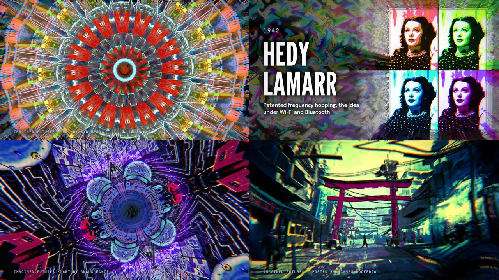

# Trip 2050

A light show for the party wall. It moves with the music in the room, turns the Imagined Futures pictures into kaleidoscopes, tunnels and liquid paint, and brings 24 innovators on stage as pop-art posters, from Archimedes to CRISPR. One page, drawn live in WebGL at the projector's size; it never repeats the same way.



The visuals under it are not new: they are [MilkDrop](https://www.geisswerks.com/milkdrop/), the music visualizer that has run behind DJs since 2001, in its browser version [Butterchurn](https://github.com/jberg/butterchurn), with 33 presets picked by eye from the community's best. The page adds the party on top of them.

## Start it

On the website it is at [`/trip`](https://vargafutureparty.com/trip/index.html). From the repo:

```bash
python3 -m http.server 4620          # in the repo folder
open http://localhost:4620/trip/     # Chrome works best
```

Press **Start with the microphone** and allow it, then `F` for full screen. The microphone only listens for the beat; nothing is recorded or sent anywhere. If the laptop cannot hear the speakers, **Start with the built-in beat** (or `B`) runs the show on a silent 126 BPM loop.

Opened as a file from disk it still plays, but the browser will not give local pictures to WebGL: the concept art then comes from X (online only) and the innovators appear as names without portraits. Served over http it needs no internet except for the fonts, and falls back to system fonts without them.

| Address | What it does |
| --- | --- |
| `?src=mic` or `?src=beat` | Starts at once, where the browser allows sound without a click (a kiosk). |
| `?scene=kaleido` | Keeps one scene: `milk`, `kaleido`, `tunnel`, `melt`, `face`, `title`. |
| `?text=0` | No names and no credits. |
| `?sound=1` | The built-in beat is audible. |
| `?quality=0.6` | Draws fewer pixels, for a slow laptop. The page also steps down by itself under 40 frames a second. |

**Keys:** `F` full screen · `Space` or `→` next scene · `1`–`6` keep one scene, `0` all scenes · `N` next visual · `A` next picture · `T` text on and off · `M` microphone · `B` built-in beat · `S` its sound · `H` the start screen with these keys.

## What plays

The director runs the scenes in a fixed order of about five and a half minutes and changes scene on a beat. Pictures and visuals are shuffled, and the innovators continue from where the last scene stopped.

| Scene | What it is |
| --- | --- |
| Title | FUTURE, PARTY, 2050, one word every two beats, throwing coloured echoes. |
| Kaleidoscope | A picture folded 6 to 16 times, turning; a new picture every 8 beats. |
| Portrait | Two innovators a scene: the year, the name, one line on what they did, and the portrait in five flat inks. Each ends as four posters in four colourways. |
| Tunnel | A flight down a tunnel whose walls are the picture, with rings of light on the beat. |
| Visual | A MilkDrop preset alone, full strength. |
| Liquid | A picture across the whole wall, stirred like wet paint. |

While a picture plays, the corner names its artist where the post does, or the account that posted it.

## How it works

Every frame has three layers.

1. **The visual.** Butterchurn draws a preset into a hidden canvas from the sound. A new preset blends in every 17 seconds. `presets.json` sorts them: `hero` presets play alone, `bg` presets sit behind the pictures and portraits at under half strength.
2. **The trails.** A half-float buffer holds the last frame. Each frame it is zoomed, turned, bent along the edges of the visual behind it, shifted in hue and faded; then the scene paints into it. That feedback is what makes the picture breathe and smear, the same idea MilkDrop is built on.
3. **The wall.** The last pass lays the trails over the visual, splits the colours on the beat, and draws the text with a dark halo so it reads over anything.

Three things are there for a projector in a dark room:

- A pale picture is darkened until its mean brightness sits at a third, and its flat areas give way to its edges, so a white sky does not flood the wall.
- The visual's mean brightness is capped at a half: a preset that flashes white is turned down for that frame. The presets that strobe were left out of the list.
- The lightest ink of a portrait is a colour, never white.

**The beat.** With the microphone, a beat is a jump in loudness under 140 Hz well over the jumps of the last second, measured against the room's own peak, so it works loud or quiet. With no music a slow clock keeps the scenes moving at a third of the kick. The built-in beat knows its own tempo.

Tested in headless Chrome 157 on the GPU: 60 frames a second at 1920×1080, every scene, the microphone path with a fake device, the file path, a 4:3 screen, and the beat detector against the built-in loop (21 of 21 beats in ten seconds, at full and at one twentieth of the volume).

## Change it

```bash
python3 -I trip/build.py                  # writes data.js and presets.js
python3 -I trip/tools/fetch_portraits.py  # downloads the portraits again and writes CREDITS.md (needs Pillow)
```

- **Innovators:** `innovators.json`. Each has a year, a line that says what happened in that year, and the name of a portrait on Wikimedia Commons; `crop` is the frame's centre and height as parts of the original. The fetch tool refuses a file that is not public domain or Creative Commons.
- **Visuals:** `presets.json`, by their names in [butterchurn-presets](https://github.com/jberg/butterchurn-presets) (1,754 to choose from). `build.py` copies the named ones out of the npm package into `presets.js`.
- **Pictures:** the page plays everything in `concept-art/tweets.json`; rebuild after Imagined Futures changes.
- **Scenes:** `SCENES`, `ORDER`, `PALETTES` and `POSTERS` near the end of `index.html`; the shaders are at its top.

Credits and licences for the portraits, Butterchurn and the presets are in [`CREDITS.md`](CREDITS.md).
